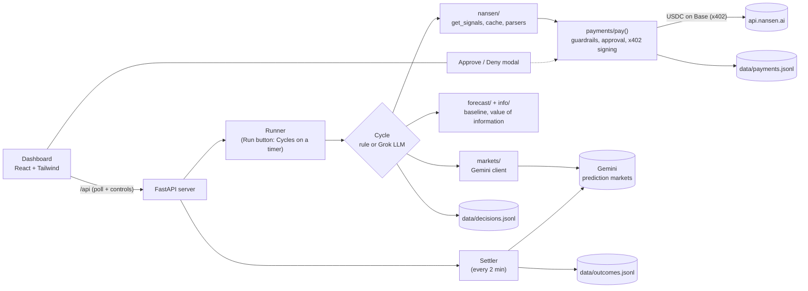

# PennyWise

**An AI trading agent that pays for on-chain data only when the data is worth more than it costs.**

PennyWise watches Gemini's crypto prediction markets. For each market it asks: *would knowing what smart money is doing on-chain change my trade enough to pay for it?* If yes, it buys the data from Nansen with a USDC micropayment on Base over x402, with no account and no API key. Then it decides whether to trade, and scores itself after the market settles.

| | |
|---|---|
| **Live demo** | https://pennywise-ubc.centralus.cloudapp.azure.com/ |
| **Demo video** | _add link_ |
| **Track** | Agentic Payments and AI (University Blockchain Conference hackathon, Nov 2026) |
| **Team** | Andrew (Gemini market data, baseline math, trade logic, scoring) · Chase (x402 wallet and Nansen calls, guardrails and human approval, dashboard) |

## The problem

AI agents are starting to pay for things themselves, and the paid-data market is moving to pay-per-call (x402). That raises two questions nobody answers well yet:

1. **When is information worth buying?** An agent that buys every data feed on every decision burns money. One that never buys trades blind. The right answer depends on the decision at hand: data is only worth paying for if it could change what you do.
2. **How do you let an agent spend real money safely?** An LLM with a wallet can be confused, looped, or prompt-injected. Limits have to live outside the model.

PennyWise addresses both in a setting where the answer is measurable: prediction markets settle to $1 or $0, so every data purchase can be scored against what it changed.

## How it works

```
Gemini markets ──► free baseline forecast ──► is Nansen data worth its price?
                                                   │ skip / Basic $0.01 / Smart Money $0.05
                                                   ▼
                            guardrails ──► human approval (above threshold) ──► x402 payment (USDC on Base)
                                                   ▼
                    informed forecast ──► trade or pass (edge after fees) ──► settle ──► score
```

1. **Scan.** Pull every live crypto prediction Event from Gemini (BTC, ETH, SOL, XRP): 5- and 15-minute "up" contracts and hourly-and-longer price ladders.
2. **Baseline forecast (free).** For each Contract, the probability the price finishes above the strike, from spot price, strike, time left and recent volatility.
3. **Value of information.** Before paying, imagine each reading Nansen might return, from strongly bearish to strongly bullish. Re-run the trade decision under each, and average the extra profit. Buy only if that beats the price. One purchase covers every Contract on that asset, so it is cached and shared.
4. **Pay with x402.** Nansen answers `402 Payment Required` with a price. PennyWise checks the offer against its own pinned allowlist, signs an EIP-3009 USDC authorization, and retries with the signature. The payment settles on Base.
5. **Informed forecast and trade.** The on-chain flows (smart-money net flow, whale and exchange flows) are reduced to one reading in [-1, 1] that nudges the forecast. A trade is taken only when the edge after Gemini's taker fee clears 3%, at most one per Event (shadow mode: simulated, 10 contracts).
6. **Settle and score.** The server settles expired Events every 2 minutes. Scoring compares the baseline forecast, the informed forecast and the market price, and shows Profit (trade P&L minus data spend) per asset, per Tier, and rule vs. LLM.

### Two agents, one set of rules

- **Rule mode:** the deterministic pipeline above.
- **LLM mode (Grok, xAI):** a tool-use loop. The model sees the markets and calls `scan_markets`, `estimate_data_value`, `buy_nansen_data`, `wallet_status` and `propose_trade`, and decides what to buy and what to trade. The tools are thin wrappers over the same code. Every purchase still goes through `pay()` and every guardrail, and trade size and the one-trade-per-Event rule stay in code. When the LLM buys data the value check said to skip, the decision is flagged, so scoring can show whether the model or the math spends better. If Grok is unreachable, the cycle falls back to rule mode.

## Architecture



| Folder | Role |
|---|---|
| `src/pennywise/markets/` | Gemini client: live Events, Contract quotes, spot prices, settled outcomes |
| `src/pennywise/forecast/` | Baseline probability; informed update from a Nansen reading |
| `src/pennywise/info/` | Value of information: skip, Basic or Smart Money |
| `src/pennywise/nansen/` | Request bodies, response parsers, cache, flows-to-reading (`interpret.py`), stub data |
| `src/pennywise/payments/` | The only code that signs: allowlist, pinned prices, budgets, kill switch, human approval, x402, wallet balance |
| `src/pennywise/trading/` | Edge after fees; picks at most one shadow trade per Event |
| `src/pennywise/agent/` | Rule cycle, Grok tool loop, the Runner behind the Run button |
| `src/pennywise/decisions/`, `scoring/` | Decision log and outcomes; settle and score |
| `src/pennywise/api/` | Thin FastAPI layer; the agent also runs without it from the CLI |
| `frontend/` | Dashboard (Vite build served by FastAPI at `/`) |
| `deploy/` | Setup and update scripts for an Ubuntu VM (systemd + Caddy HTTPS) |

## Safety: the model can trigger spending, never control it

Every limit is plain code that runs **before** a payment is signed. The LLM can only call tools that go through that code.

- **Allowlist:** pays only `api.nansen.ai`, only two endpoints, only to Nansen's pay-to address, only in USDC on Base.
- **Pinned prices:** every 402 offer must match the price pinned in code ($0.01 / $0.05). Anything else is treated as price drift and refused. Hard cap: $0.05 per call.
- **Budgets:** per Feed (asset × Tier) per day, per Run (settable when you press Run, never above the `.env` cap), and per day. The daily budget is summed from an append-only ledger, so it survives restarts. Every signed payment is recorded *before* it is sent.
- **Human approval:** purchases at or above a threshold you set wait 90 s for Approve/Deny on the dashboard. No answer refuses the purchase **and** trips the kill switch.
- **Kill switch:** one click stops all spending and all trading. A `.env` lock overrides the dashboard.
- **Pause after failures:** after 3 failed payments in a row, the agent stops paying.
- **Balance check:** refuses to sign if the on-chain USDC balance can't cover the price.
- **Prompt-injection defence:** Nansen responses are reduced to numbers before the LLM sees them.
- **Small blast radius:** the wallet holds about $5, and trades are simulated.

## On-chain details

| | |
|---|---|
| Network | Base mainnet (`eip155:8453`) |
| Payment protocol | x402 v2, `exact` scheme: EIP-3009 `transferWithAuthorization`, gasless for the agent |
| USDC on Base | [`0x833589fCD6eDb6E08f4c7C32D4f71b54bdA02913`](https://basescan.org/token/0x833589fCD6eDb6E08f4c7C32D4f71b54bdA02913) |
| Nansen pay-to | [`0x93053f1e7A5eFEDa532Fe69CbbE43cBEc3A0F13f`](https://basescan.org/address/0x93053f1e7A5eFEDa532Fe69CbbE43cBEc3A0F13f) |
| Agent wallet | [`0xfb7c1232a7a31FFb5C65b94A8A216AB33f3745aB`](https://basescan.org/address/0xfb7c1232a7a31FFb5C65b94A8A216AB33f3745aB) |
| Example payments | [$0.01 Basic](https://basescan.org/tx/0x74ccdd0728ff53b92f10f54d28b684a62559c2e335aeda797e3af194343a2096) · [$0.05 Smart Money](https://basescan.org/tx/0xa479dc1bf7b642851c25f901489c129e5c1b38e07d9eb0bd4cf8b93e1aa1519b) |

Nansen data used: `smart-money/netflow` (Smart Money Tier, 1-hour smart-money net flow, for 1H ladders) and `tgm/flow-intelligence` (Basic Tier, 5-minute smart-trader, whale and exchange flows, for 5- and 15-minute contracts), for ETH on Ethereum and SOL on Solana. Nansen has no XRP coverage and only wrapped BTC, so BTC and XRP trade on the free baseline alone.

## Technologies

- **Blockchain and payments:** Base, USDC, x402 (Coinbase's HTTP payment standard), EIP-3009 / EIP-712 signing with `eth-account`
- **Data and markets:** Nansen x402 API (on-chain flows on Ethereum and Solana), Gemini prediction markets (public API)
- **AI:** xAI Grok via the OpenAI-compatible SDK (tool calling)
- **Backend:** Python 3.11+, FastAPI, httpx, uv
- **Frontend:** React, TypeScript, Tailwind CSS, Vite
- **Hosting:** Azure VM (Ubuntu 24.04), systemd, Caddy (automatic HTTPS)

## Running it

Requirements: Python 3.11+ with [uv](https://docs.astral.sh/uv/), Node 22.

```bash
cp .env.example .env            # wallet key, budgets, Grok key; NANSEN_STUB=true = fake data, no spending
uv sync
cd frontend && npm ci && npm run build && cd ..
uv run uvicorn pennywise.api.app:app
```

Open http://127.0.0.1:8000/ and press **Run**: choose rules or LLM, once or on repeat, and a budget for the Run. With `NANSEN_STUB=false`, the Run pays real USDC, and the dashboard asks you to confirm.

Useful commands:

- `uv run python -m pennywise.markets.gemini`: free scan of live Events with the buy/skip decision per asset and Tier
- `uv run python -m pennywise.agent.runner --every 2m [--mode llm] [--live]`: Runs from a terminal
- `uv run python -m pennywise.payments --dry-run`: check every guardrail and sign, without paying
- `uv run python -m pennywise.scoring.score`: Profit and forecast accuracy

Deploying to a fresh Ubuntu VM: `bash deploy/setup.sh <hostname>` (see the script's header). Updates: `bash deploy/update.sh`.

## What we verified

- x402 payments to Nansen work end to end on Base mainnet (first tested Nov 14 for ETH, Nov 20 for SOL).
- Smart Money returns a native-ETH and native-SOL row (SOL: 178 smart-money traders). Basic is coarse: for ETH, mostly exchange flow; for SOL, exchange and whale flow, no smart traders.
- Human approval works across processes: approve, deny and timeout were tested, and a timeout trips the kill switch. Stopping a Run denies its pending approval at once.

## Limitations (honest)

- Whether paid data beats its cost is still being measured. The live log started Nov 19, and short-horizon markets are noisy.
- SOL's flow scales are rough guesses from one live call per Tier. ETH's were set to match our stub data.
- Trades are simulated at the quoted price, with Gemini's fee. No real orders are placed.
- One server process holds the Runner and the in-memory guardrail locks, so it is deployed as a single instance.

## What's next

- **Sell our forecasts over x402**, so PennyWise both buys data and sells insight to other agents.
- **Voice approval** for large purchases, next to the dashboard modal.
- **On-chain receipt check:** confirm each x402 payment settled on Base for the right amount before trusting the data.
- **A narrator:** the LLM explains each Cycle in plain language from the decision log.
- **Calibrate from results:** learn flow scales and the value-of-information priors from settled outcomes, per asset.
- **Real orders** on Gemini once the informed forecast shows a lasting edge.
